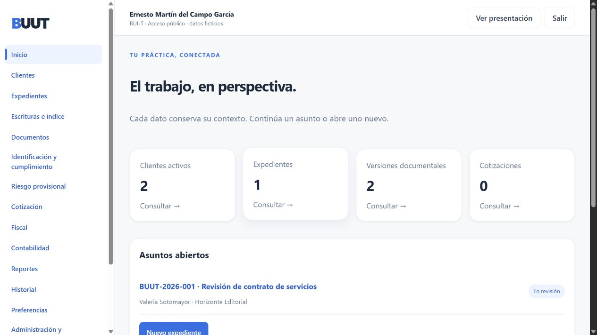

<h1 align="center">Gerardo Escobar</h1>

  <strong>Ingeniería de robótica y software · Desarrollo de productos</strong> 
  Del control embebido a las interfaces que usan las personas.

  Ingeniero en Mecatrónica · Estudiante de Doctorado en Ciencias de la Ingeniería 
  Tecnológico de Monterrey · Guadalajara, México

  <a href="https://www.linkedin.com/in/gerardo-escobar-dc/">LinkedIn</a> ·
  <a href="https://orcid.org/0009-0008-4998-9274">ORCID</a> ·
  <a href="https://gerardodc14.github.io/buut/">Probar BUUT</a> ·
  <a href="./README.md">English</a>

---

Desarrollo productos de software y sistemas robóticos que conectan **aplicaciones web, dispositivos embebidos y máquinas autónomas**. Mi trabajo reúne diseño de interfaces, arquitectura, implementación y validación: desde organizar un flujo de trabajo notarial hasta coordinar sensores y actuadores de un robot.

## Proyectos destacados

### BUUT · Software para la operación jurídica y notarial

Desarrollo la interfaz web, el backend, el modelo de datos y el despliegue de BUUT. La aplicación reúne clientes, asuntos, documentos, cotizaciones e historial de actividad, con controles de acceso y versiones documentales.

**Enfoque de ingeniería:** convertir requisitos del dominio en pantallas claras, aplicar permisos desde el backend y conservar trazabilidad de cambios y recuperación.

`React` · `TypeScript` · `Rust` · `SQLite`

[Explorar la demo pública](https://gerardodc14.github.io/buut/) — datos ficticios guardados en el navegador. El piloto privado independiente está desplegado; la aprobación sustantiva y la aceptación de usuarios siguen en proceso. El código fuente es privado.

   
  BUUT · Demostración pública con datos ficticios.

### RoboCorea · Robótica en equipo

Contribuí con **14 pull requests integrados** al repositorio del equipo de RoboCup Rescue, con trabajo en autonomía, percepción, herramientas de operación e integración de hardware.

**Enfoque de ingeniería:** procesar las nubes de puntos 3D en el robot y enviar un OctoMap compacto a la interfaz de operación para atender la congestión de red. Otras contribuciones conectan navegación, sensores y servicios del robot con los controles del operador.

`ROS 2` · `C++` · `Python` · `Nav2` · `OctoMap` · `Jetson`

[Repositorio del equipo](https://github.com/arepo90/RoboCorea) · [Contribuciones integradas](https://github.com/arepo90/RoboCorea/pulls?q=is%3Apr+is%3Amerged+author%3AGerardoDC14) · [Implementación de mapeo 3D](https://github.com/arepo90/RoboCorea/pull/14)

### PadelSystem · Un producto conectado con cuatro interfaces

Desarrollo una plataforma de marcadores para canchas que conecta dispositivos ESP32, un portal de administración en React, un servidor FastAPI y pantallas Raspberry Pi.

**Enfoque de ingeniería:** mantener un estado único del partido, tratar eventos duplicados y conservar el estado de las pantallas durante desconexiones temporales. El proyecto está en desarrollo y preparación de despliegue.

`FastAPI` · `React` · `TypeScript` · `WebSockets` · `ESP-IDF` · `Raspberry Pi`

[Código, capturas del producto y arquitectura](https://github.com/GerardoDC14/PadelSystem)

## Trabajo actual

<!-- CURRENT-FOCUS:START -->
*Revisado: 16 de noviembre de 2026*

| Línea de trabajo | Etapa actual | Enfoque |
|---|---|---|
| **BUUT** | Piloto privado desplegado; demo pública disponible | Mejora de flujos, validación y aceptación |
| **Investigación doctoral** | Investigación en desarrollo; código privado | Control consciente de capacidades y transferencia de habilidades entre configuraciones robóticas |
| **Desk Hub Robotec** | Proyecto público de hardware e interfaces | Interacción táctil, estado persistente e integración de servicios en Raspberry Pi |
<!-- CURRENT-FOCUS:END -->

[Explorar Desk Hub Robotec](https://github.com/GerardoDC14/desk-hub-robotec): vistas de la interfaz, arquitectura y documentación de instalación.

## Responsabilidad técnica y colaboración

- **Entrega de producto:** conectar los flujos de uso con frontend, backend, despliegue y procedimientos de recuperación en BUUT.
- **Integración en equipo:** aportar cambios revisables a un repositorio compartido de robótica, con notas de implementación y evidencia de validación.
- **Comunicación técnica:** documentar arquitectura, procedimientos de operación y límites conocidos para que otras personas puedan ejecutar y evaluar el trabajo.

## Investigación y trayectoria

**Actualidad · Estudios de Doctorado en Ciencias de la Ingeniería, Tecnológico de Monterrey**  
Línea de investigación: control consciente de capacidades y transferencia de habilidades en el espacio de tarea para manipulación móvil bajo incertidumbre.

**2024–2026 · RoboCup Rescue Robot League**  
Clasificación a tres ediciones consecutivas: Eindhoven, Salvador e Incheon.

## Más proyectos de ingeniería

| Proyecto | Enfoque |
|---|---|
| [Arm-TMR-2026](https://github.com/GerardoDC14/Arm-TMR-2026) | Manipulación, MoveIt 2 e integración de actuadores |
| [CAN-Control-Odrive](https://github.com/GerardoDC14/CAN-Control-Odrive) | Herramientas de control de motores, telemetría e integración CAN |
| [TurtleBot3 Autonomy Stack](https://github.com/GerardoDC14/TurtleBot3-Autonomy-Stack) | Exploración y navegación; referencia histórica del portafolio |
| [Wheelchair Assist Drive Module](https://github.com/GerardoDC14/Wheelchair-Assist-Drive-Module) | Firmware STM32, actuación BLDC y diagnóstico integrado |

<strong>Herramientas con las que trabajo</strong>

- **Software e interfaces:** Python, Rust, React, TypeScript, FastAPI, Qt, SQLite.
- **Robótica y control:** ROS 2, Nav2, MoveIt 2, C/C++, MATLAB, OpenCV.
- **Sistemas embebidos:** ESP32, STM32, Raspberry Pi, Jetson, CAN, UART, I²C, SPI.
- **Entrega y validación:** Git, Linux, Docker, pytest, Playwright, GitHub Actions.

---

¿Te interesa colaborar en robótica, productos conectados o desarrollo de software? [Conversemos en LinkedIn](https://www.linkedin.com/in/gerardo-escobar-dc/).
