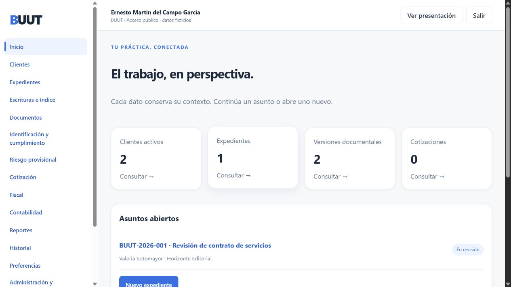

<h1 align="center">Gerardo Escobar</h1>

  <strong>Robotics &amp; Software Engineer · Product Builder</strong> 
  From embedded control to the interfaces people use.

  Mechatronics Engineer · PhD Student in Engineering Sciences 
  Tecnológico de Monterrey · Guadalajara, Mexico

  <a href="https://www.linkedin.com/in/gerardo-escobar-dc/">LinkedIn</a> ·
  <a href="https://orcid.org/0009-0008-4998-9274">ORCID</a> ·
  <a href="https://gerardodc14.github.io/buut/">Try BUUT</a> ·
  <a href="./README.es.md">Español</a>

---

I build software products and robotic systems across **web applications, embedded devices, and autonomous machines**. My work connects interface design, system architecture, implementation, and validation—from organizing a notarial workflow to coordinating a robot's sensors and actuators.

## Selected work

### BUUT · Software for legal and notarial workflows

I develop BUUT across its web interface, backend, data model, and deployment. It brings clients, matters, documents, quotations, and activity history into a shared workflow, with access controls and document versioning.

**Engineering focus:** translating domain requirements into usable screens, enforcing permissions in the backend, and making changes and recovery traceable.

`React` · `TypeScript` · `Rust` · `SQLite`

[Explore the public demo](https://gerardodc14.github.io/buut/) — fictional data stored in your browser. The separate private pilot is deployed; domain approval and user acceptance remain in progress. Source code is private.

   
  BUUT · Public demonstration with fictional data.

### RoboCorea · Robotics built with a team

I contributed **14 merged pull requests** to the team's RoboCup Rescue repository, covering autonomy, perception, operator tools, and hardware integration.

**Engineering focus:** keeping heavy 3D point-cloud processing on the robot and sending a compact OctoMap to the operator interface to address network congestion. Other contributions connect navigation, sensors, and robot services to operator controls.

`ROS 2` · `C++` · `Python` · `Nav2` · `OctoMap` · `Jetson`

[Team repository](https://github.com/arepo90/RoboCorea) · [Merged contributions](https://github.com/arepo90/RoboCorea/pulls?q=is%3Apr+is%3Amerged+author%3AGerardoDC14) · [3D mapping implementation](https://github.com/arepo90/RoboCorea/pull/14)

### PadelSystem · A connected product across four interfaces

I develop a court-scoring platform connecting ESP32 wearables, a React management portal, a FastAPI server, and Raspberry Pi displays.

**Engineering focus:** one authoritative match state, duplicate-event handling, and displays that retain state through temporary disconnections. The project is in development and deployment preparation.

`FastAPI` · `React` · `TypeScript` · `WebSockets` · `ESP-IDF` · `Raspberry Pi`

[Source, product screenshots & architecture](https://github.com/GerardoDC14/PadelSystem)

## Currently building

<!-- CURRENT-FOCUS:START -->
*Reviewed: 16 November 2026*

| Workstream | Current stage | Focus |
|---|---|---|
| **BUUT** | Private pilot deployed; public demo available | Workflow refinement, validation, and acceptance |
| **Doctoral research** | Research in development; private codebase | Capability-aware control and skill transfer across robotic embodiments |
| **Desk Hub Robotec** | Public hardware and interface project | Touch interaction, persistent state, and service integration on Raspberry Pi |
<!-- CURRENT-FOCUS:END -->

[Explore Desk Hub Robotec](https://github.com/GerardoDC14/desk-hub-robotec) for interface previews, architecture, and setup documentation.

## Engineering ownership & collaboration

- **Product delivery:** connect user workflows to frontend, backend, deployment, and recovery procedures in BUUT.
- **Team integration:** contribute reviewable changes to a shared robotics codebase, with implementation notes and validation evidence.
- **Engineering communication:** document architecture, operating procedures, and known limits so others can run and assess the work.

## Research & trajectory

**Current · Doctoral studies in Engineering Sciences, Tecnológico de Monterrey**  
Research direction: capability-aware control and task-space skill transfer for mobile manipulation under uncertainty.

**2024–2026 · RoboCup Rescue Robot League**  
Qualified for three consecutive editions: Eindhoven, Salvador, and Incheon.

## More engineering work

| Project | Focus |
|---|---|
| [Arm-TMR-2026](https://github.com/GerardoDC14/Arm-TMR-2026) | Manipulation, MoveIt 2, and actuator integration |
| [CAN-Control-Odrive](https://github.com/GerardoDC14/CAN-Control-Odrive) | Motor-control tooling, telemetry, and CAN integration |
| [TurtleBot3 Autonomy Stack](https://github.com/GerardoDC14/TurtleBot3-Autonomy-Stack) | Exploration and navigation; historical portfolio reference |
| [Wheelchair Assist Drive Module](https://github.com/GerardoDC14/Wheelchair-Assist-Drive-Module) | STM32 firmware, BLDC actuation, and onboard diagnostics |

<strong>Tools I work with</strong>

- **Software & interfaces:** Python, Rust, React, TypeScript, FastAPI, Qt, SQLite.
- **Robotics & control:** ROS 2, Nav2, MoveIt 2, C/C++, MATLAB, OpenCV.
- **Embedded systems:** ESP32, STM32, Raspberry Pi, Jetson, CAN, UART, I²C, SPI.
- **Delivery & validation:** Git, Linux, Docker, pytest, Playwright, GitHub Actions.

---

Interested in robotics, connected products, or software development? [Connect with me on LinkedIn](https://www.linkedin.com/in/gerardo-escobar-dc/).
